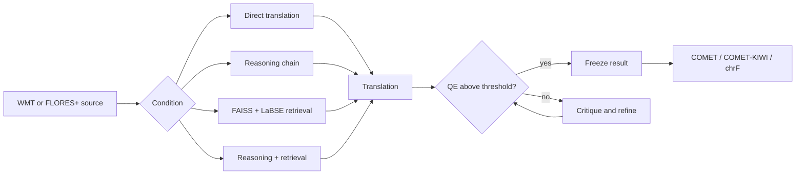

# Agentic MT

Research workflows for testing when reasoning, retrieval, quality estimation, and iterative refinement improve multilingual machine translation—and when they fail.

The project compares controlled translation conditions using the same source sentences and models. Its retrieval condition uses a held-out translation memory indexed with LaBSE embeddings and FAISS. Its refinement study routes low-confidence translations through another revision step using either model self-critique or COMET-KIWI quality estimation.

## What this repository demonstrates

- Retrieval-augmented translation with FAISS and multilingual LaBSE embeddings.
- Four controlled conditions: direct translation, multi-step reasoning, retrieval, and reasoning plus retrieval.
- Conditional routing based on external quality-estimation thresholds.
- Iterative translate → estimate → refine workflows with early freezing of acceptable translations.
- COMET, COMET-KIWI, and chrF evaluation with paired bootstrap comparisons.
- Reproducible WMT/FLORES+ sampling, prompt traces, cached outputs, and SLURM execution.

## Architecture



The tools and routes are ordinary Python components. The experiments do not use LangChain, LangGraph, AutoGen, CrewAI, autonomous external-tool selection, or long-term user memory.

## Representative result

In the Phase 3 controlled comparison, retrieval without a reasoning chain (`l1_tool`) was the strongest condition on both English→German and English→Hausa across COMET, COMET-KIWI, and chrF. Multi-turn reasoning frequently degraded with Aya-101 because the encoder-decoder model was not conversation-tuned; the result is evidence for retrieval in this setup, not a general claim that reasoning harms translation.

| Pair | Baseline COMET | Retrieval COMET | Baseline chrF | Retrieval chrF |
|---|---:|---:|---:|---:|
| en→de | 0.821 | **0.843** | 53.3 | **59.5** |
| en→ha | 0.762 | **0.780** | 42.2 | **45.5** |

See [`results/phase_3_summary.md`](results/phase_3_summary.md) for the complete experiment, significance tests, and limitations. Later smoke tests in [`results/phase_6_summary.md`](results/phase_6_summary.md) show that target-language pretraining exposure can impose a generation floor before an agentic comparison is meaningful.

## Repository layout

```text
src/agentic_mt/
  pipelines/     controlled translation and FAISS retrieval conditions
  refinement/    critique/QE routing and iterative refinement
  triggering/    source-feature extraction and trigger modeling
  qe/            QE-versus-human-judgment analysis
configs/          experiment configurations and schema
scripts/          SLURM launchers and analysis utilities
results/          compact phase summaries and selected evidence
reports/          research report source and figures
tests/            offline regression tests
```

Large datasets, checkpoints, prompt logs, and per-run outputs are intentionally excluded.

## Setup

Python 3.10 is recommended:

```bash
uv sync
```

Some experiments depend on a local AmanaMT checkout containing cached metric scores. Set its location before running the QE study:

```bash
export MQMBENCH_ROOT=/path/to/amana-mt
```

## Running experiments

Run the four-condition translation study:

```bash
uv run python -m agentic_mt.pipelines.run_experiment \
  --config configs/pipelines_l1_conditions.yaml \
  --pair en-ha \
  --generate
```

Run conditional iterative refinement:

```bash
uv run python -m agentic_mt.refinement.run_experiment \
  --config configs/refinement_tear.yaml \
  --generate
```

Configuration conventions are documented in [`configs/schema.md`](configs/schema.md). Cluster launchers live under `scripts/`.

## Tests

The lightweight tests avoid model downloads and GPUs:

```bash
PYTHONPATH=src pytest
```

## Limitations

- Several studies use small, deliberately controlled samples rather than production traffic.
- Retrieval quality and refinement decisions depend on pretrained LaBSE and COMET-family models.
- Phase 3's multi-turn conditions are confounded by Aya-101's weak conversation behavior.
- Phase 6 contains only five language points and supports a generation-floor observation, not a universal scaling curve.

## License

MIT. Dataset and model artifacts remain subject to their original licenses.
